<a href="https://vamshidhar-portfolio.netlify.app/">
  
</a>

  
  
  
  




<a href="https://github.com/vamshidharre/Modal_Analysis"></a>

  
  

<a href="https://vamshidhar-portfolio.netlify.app/"></a>

  
  

<a href="https://vamshidhar-portfolio.netlify.app/"></a>

  
  

<a href="https://vamshidhar-portfolio.netlify.app/"></a>

  
  



  
  


  
  
  
  

